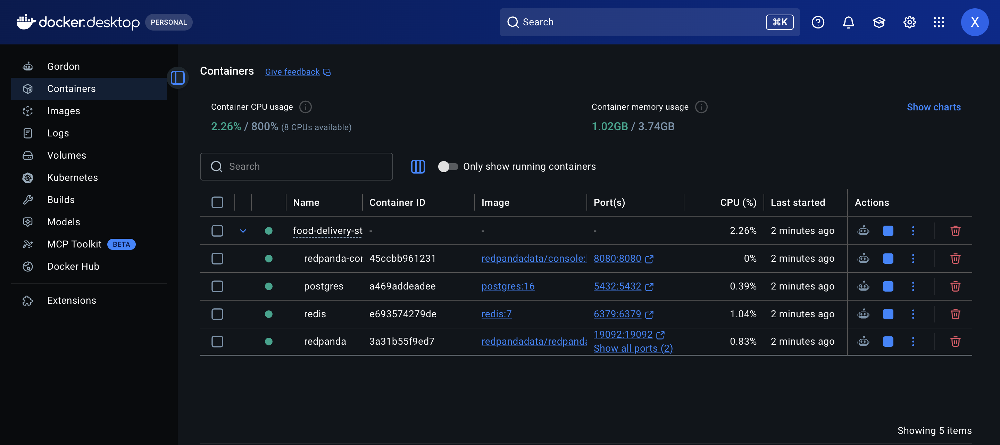
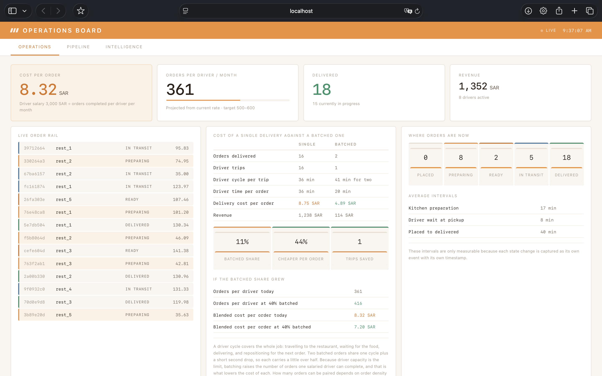
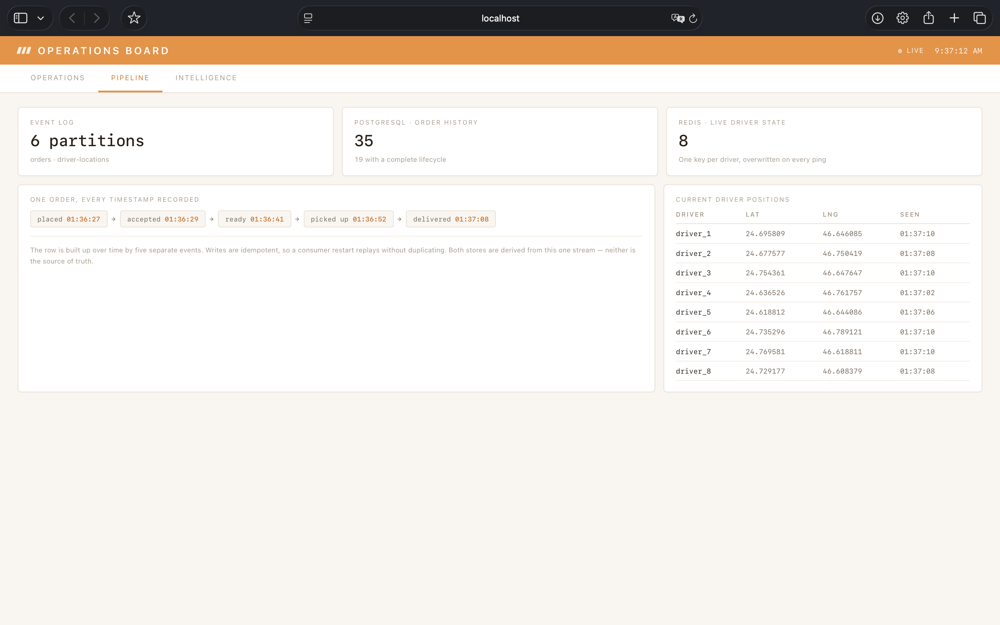
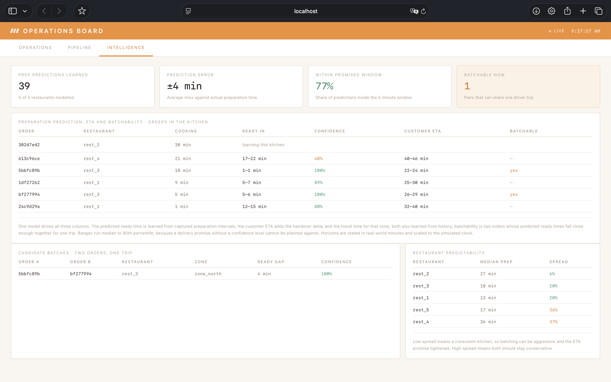

# ai-ready-data-pipeline

An event-driven data platform for a food delivery operation: a streaming
pipeline, two storage engines chosen for different access patterns, a
preparation-time prediction model, and a live operations board that turns the
event stream into the unit economics of the business.

Runs entirely on one machine through Docker Compose.


**Stack:** Python · Redpanda (Kafka API) · Apache Spark Structured Streaming ·
PostgreSQL · Redis · Docker Compose

---

## What it does

Every order emits five separate events as it moves through its lifecycle.
Because each is timestamped, the intervals between them become measurable, and
those intervals are what everything else is built on.

```
                                    ┌──────────────────────────────────┐
                                    │ PostgreSQL                       │
                                ┌──▶│ full order history, transactional│
                                │   └──────────────────────────────────┘
┌───────────┐   ┌───────────┐   │   ┌──────────────────────────────────┐
│ Simulated │──▶│ Redpanda  │───┼──▶│ Redis                            │
│ operation │   │ event log │   │   │ current driver position, O(1)    │
└───────────┘   └───────────┘   │   └──────────────────────────────────┘
                                │   ┌──────────────────────────────────┐
                                └──▶│ Prediction & operations board    │
                                    │ readiness, batching, unit cost   │
                                    └──────────────────────────────────┘
```

Three independent consumer groups read the same log without affecting each
other, each deriving a different view from it.

---

## The operations board

Three views over one event stream, at `http://localhost:8090`.

**Operations** — cost per order, orders per driver per month, live order flow,
and the cost of a single delivery against a batched one.



**Pipeline** — partitions, both storage engines, and one order's complete
timestamp chain.



**Intelligence** — preparation-time prediction, customer arrival estimates, and
which orders can share a driver trip.



```
                          Single    Batched
Driver cycle per trip     37 min    44 min for two
Driver time per order     37 min    22 min
Delivery cost per order  8.89 SAR  5.23 SAR

Orders per driver today                363
Orders per driver at 40% batched       404
```

Costs are allocated by the driver minutes each delivery actually consumes, so
the two figures reconcile exactly with the headline cost per order.

---

## The prediction model

Preparation time is the only input in the chain that cannot be observed from
outside the kitchen, and both batching and arrival estimates depend on it.

The model fits an empirical distribution per restaurant from captured
preparation intervals, then conditions on how long an order has already been
cooking. It returns a distribution rather than a point estimate, because the
decisions downstream are risk decisions: committing a driver to two orders, or
promising a customer an arrival time.

- **Prediction error** around four minutes against actual preparation time
- **Confidence** is the probability the actual result lands within five minutes
  of the prediction, which separates consistent kitchens from erratic ones
- **Declines to predict** below five observations, and flags orders that have
  passed every recorded preparation time rather than reporting false certainty

Backtested against completed orders, not asserted.

---

## Concepts demonstrated

| Concept                            | Where it appears                                      |
| ---------------------------------- | ----------------------------------------------------- |
| Append-only log as source of truth | State is derived from events, never stored directly   |
| Partitioning and message keys      | Orders keyed by restaurant, positions by driver       |
| Ordering guarantees                | Per-partition ordering through consistent key hashing |
| Consumer groups                    | Three independent groups, separate offsets            |
| At-least-once delivery             | Idempotent writes absorb replayed messages            |
| Event-time windowing               | Aggregation by when an order was placed, not read     |
| Watermarks                         | Bounded tolerance for late-arriving events            |
| Stateful stream processing         | Running window totals, checkpointed to disk           |
| Streaming materialized view        | Summary table kept current by upsert                  |
| Polyglot persistence               | Transactional history against low-latency state       |

---

## Getting started

Requires Docker, Python 3.10 to 3.12, and Java 17 for the Spark jobs.

```bash
git clone https://github.com/Mo3203/ai-ready-data-pipeline.git
cd ai-ready-data-pipeline

/Library/Frameworks/Python.framework/Versions/3.12/bin/python3.12 -m venv venv
source venv/bin/activate          # Windows: venv\Scripts\activate
python --version
pip install -r requirements.txt
pip install --upgrade pip
pip install confluent-kafka 'psycopg[binary]' redis
python -c "import confluent_kafka, psycopg, redis; print('ready')"

bash scripts/setup.sh             # start services, create topics
python tools/check_environment.py # verify connectivity
```

### Run the operations board

```bash
bash scripts/reset_data.sh
bash scripts/run_board.sh
```

Open `http://localhost:8090` and allow five minutes for the model to gather
enough history.

### Run the individual pipeline components

```bash
python pipeline/producer.py                # generate events
python pipeline/orders_to_postgres.py      # persist order history
python pipeline/drivers_to_redis.py        # track current positions
python pipeline/spark_windowed_counts.py   # windowed aggregation
python tools/show_stores.py                # inspect both stores
```

---

## Repository layout

```
pipeline/    event generation and stream consumers
analytics/   preparation-time prediction and batching
dashboard/   operations board and its data endpoints
tools/       environment checks and inspection utilities
scripts/     service lifecycle
docs/        setup notes and concept reference
```

---

## Design decisions

**Message keys determine partitioning.** Orders are keyed by restaurant and
positions by driver, so events for one entity stay ordered while different
entities are consumed in parallel.

**Writes are idempotent.** Delivery is at-least-once and offsets commit
periodically, so a restart replays recent messages. Inserts use conflict
clauses, making reprocessing a no-op rather than a source of duplicates.

**Storage is chosen per access pattern.** Orders involve money and need
transactions, history and ad-hoc queries. Driver positions need a single-key
lookup with no history, so the Redis keyspace stays constant regardless of event
volume.

**Aggregation uses event time.** Orders are bucketed by when they were placed,
so a lagging consumer cannot shift results into the wrong interval.

**Predictions are distributions.** A single estimated time cannot support a risk
decision. Ranges run median to ninetieth percentile, with an explicit confidence
figure.

**Costs are allocated by driver time consumed.** A batched pair shares one
driver cycle, so each order carries a little over half of it. Every figure on
the board derives from measured intervals rather than assumption.

---

## Simulation parameters

The simulated operation is calibrated against real delivery benchmarks and runs
compressed, so a demonstration completes in minutes. All displayed durations are
converted back to the real-world minutes they represent.

| Measure                    | Simulated      | Typical real range |
| -------------------------- | -------------- | ------------------ |
| Kitchen preparation        | 18 min median  | 10–30 min          |
| Order to doorstep          | 38 min         | 30–50 min          |
| Orders per driver per hour | 2.6            | 2–3                |
| Order value                | 88 SAR average | 40–120 SAR         |

---

## Possible extensions

- Add kitchen queue depth and time of day as model features
- Reimplement the windowed aggregation in Apache Flink
- Stream-table joins to enrich orders with restaurant metadata
- Anomaly detection for stalled orders or implausible driver movement

---

## Scope

Built to understand streaming systems and their economics from first principles.
It runs a single broker with no replication on one machine. A production
deployment would add multi-broker replication, a schema registry, consumer lag
monitoring, managed secrets and a cluster-mode Spark deployment.

## License

MIT, see [LICENSE](LICENSE).
